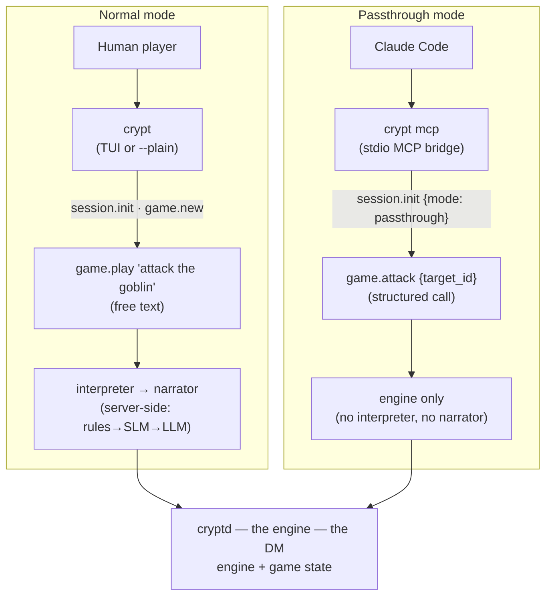
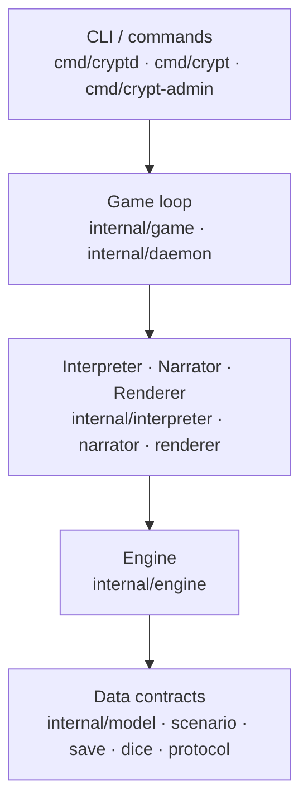
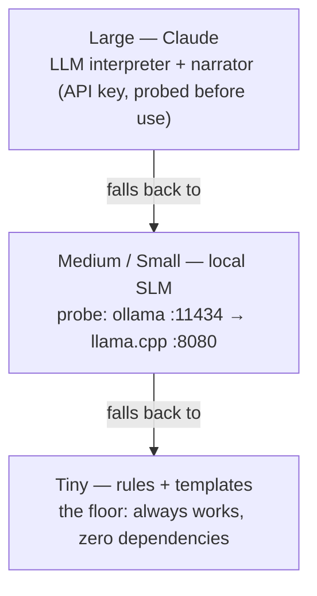
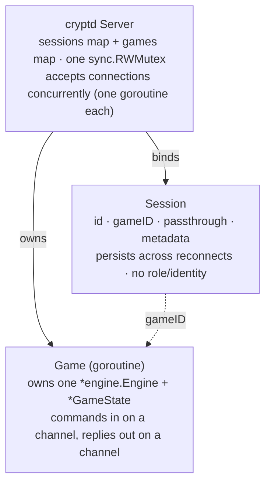

# cryptd Architecture (As-Built)

This is the authoritative, read-this-first map of how cryptd actually works,
reconstructed from the source. It exists because the design record drifted from
the code and cost real time to untangle. When this document and an older ADR
disagree about the running system, trust this document and the code; file a fix.

**Scope:** what the code does today on `main`. Rationale and rejected
alternatives live in [`DESIGN.md`](../DESIGN.md) (the ADR log); this file is the
structural map, not the decision history.

## The one idea

**The game engine is the Dungeon Master.** The deterministic Go engine — world,
rooms, combat, inventory, rules — *is* the DM. It runs as a long-lived server
(`cryptd`). Clients connect *to* it.

"Deterministic" means the rules run in code, not in a language model: no state
transition is decided by probabilistic model output. Dice still roll
(`math/rand`); that is the engine exercising control, not chance delegated to a
model.

A language model, when configured, is an **enhancement layer** — it parses
ambiguous free text and writes richer prose. Remove it and the rules + templates
do the same two jobs. The DM never disappears, because the engine is always
there. This corrects the "LLM as DM" framing of DES-009 (see DES-030).

The trap to avoid: **do not confuse the game engine with the narration layer.**
Interpreting input and narrating events is one role (the enhancement layer); it
is distinct from the DM (the engine), which decides outcomes. The enhancement
layer can be a template, a small local model, or a full LLM, and it can run on
the server or on the client — but wherever it runs and however smart it is, it
never becomes the DM. It turns intent into a `game.*` call and an event into
prose; the engine decides what actually happens.

### There is no "DM" and no "player" in the code

Nothing connects *as* the DM — the engine *is* the DM, and it is the thing you
connect *to*. A `Session` (`internal/daemon/session.go`) holds an id, a bound
game id, one `passthrough` flag, and a metadata snapshot. **There is no role, no
identity, and no player-vs-DM privilege anywhere in the code.** The only
distinction between connections is *mode*, chosen at `session.init`. Any design
question framed as "which client is the DM" is built on a premise the code does
not have. (See [Documented vs. built](#documented-vs-built).)

## The three binaries

| Binary | Role | What it is |
|---|---|---|
| `cryptd` | the server · the DM | The game engine as a network service. Daemonizes by default (sshd-style). Holds all state. `serve` (Unix socket or TCP), `-f` foreground, `-t` stdin/stdout testing. `validate` is deprecated — use `crypt-admin`. |
| `crypt` | the client | "telnet, but better." Connects to `cryptd`; forks one automatically if the local socket is absent. Bubble Tea TUI by default on a terminal, `--plain` readline fallback. `crypt mcp` is the stdio bridge for Claude Code. |
| `crypt-admin` | scenario authoring | Builds scenarios graph-first (valid by construction), then decorates with content via visitors. `generate`, `validate`, `export`. |

## Two request paths, one engine

This is the distinction that matters and the one the old docs blurred. A session
is **normal** or **passthrough**. The client requests a mode via the `mode`
field in `session.init`, but the server has the final say: if it was built
without an interpreter and narrator, every session is passthrough regardless of
what the client asked for (`passthrough = mode == "passthrough" || !hasNormalMode()`,
`internal/daemon/handler.go`). The mode is recomputed on each `session.init`
(last-init-wins), not pinned for the session's lifetime. Same engine underneath;
the difference is who parses the text and who writes the prose.



In passthrough, Claude Code *is* the interpreter and narrator; in normal mode
the server fills those roles itself. Both paths resolve against the same engine
and game state.

### Why two modes

The two modes exist because of **where an LLM is already available to pay for
the enhancement layer** (interpretation + narration):

- **Inside Claude Code (passthrough):** the player already has an LLM — Claude,
  in the session they are running. So the enhancement layer runs client-side and
  reuses that LLM. The server needs no API key and no model of its own; it just
  runs the engine and returns structured JSON for Claude Code to interpret and
  narrate.
- **Other clients (normal):** the `crypt` TUI and `--plain` client are plain
  terminals with no LLM of their own. So if LLM-grade narration or parsing is
  wanted, the **server** must supply the brain — a Claude API key, a local SLM,
  or the rules + template floor. The brain has to live somewhere, and here the
  only place is the server.

Same engine, same DM, same enhancement *role* — the difference is just who
already has an LLM to spend on that role. Passthrough reuses the one the player
brought; normal mode has to bring its own.

Like the rest of the game's design, it is unproven that this split is the best
architecture. It is here because it makes sense to enable gameplay with the LLM
people already have access to, rather than requiring every player to supply the
server with a key.

**Which methods each path uses:**

- The interactive `crypt` client drives *gameplay* entirely through
  `game.play` (free text). Combat hotkeys in the TUI (`a`/`d`/`f`/`u`)
  synthesize free text like `"attack"` and send it through `game.play` — they
  do not call granular methods. The `--plain` client calls only `session.init`,
  `game.new`, and `game.play`; the TUI also calls `game.list_scenarios` and
  `game.list_sessions` to populate its lobby and resume screens.
- The granular gameplay methods — `game.move`, `game.attack`, `game.look`,
  `game.pick_up`, and the rest — exist **only** for passthrough (`crypt mcp`).
- The server enforces the split: it rejects the granular `game.*` gameplay
  calls in normal mode, and rejects `game.play` in passthrough mode
  (`internal/daemon/handler.go`). (`game.list_scenarios` and
  `game.list_sessions` are mode-independent and answered directly by the
  server in either mode.)

## Layers and dependency direction

Dependencies flow strictly downward — a build-order red line. The engine knows
nothing of interpreters; interpreters know nothing of narrators; narrators know
nothing of renderers.



| Layer | Packages | What it does |
|---|---|---|
| CLI / commands | `cmd/cryptd`, `cmd/crypt`, `cmd/crypt-admin` | Binaries. Flag parsing, daemonize, client connect, the Bubble Tea TUI. |
| Game loop | `internal/game`, `internal/daemon` | Wires interpreter + narrator + renderer around the engine. The daemon runs each game as a goroutine. |
| Interpreter · Narrator · Renderer | `internal/interpreter`, `internal/narrator`, `internal/renderer` | The three swappable seams. Rules/SLM/LLM · Template/SLM/LLM · CLI/Autoplay/RPC-wire. |
| Engine | `internal/engine` | Deterministic rules: Move, Look, combat, inventory, spells, leveling, save/load. Holds no state — mutates a passed-in `*GameState`. |
| Data contracts | `internal/model`, `scenario`, `save`, `dice`, `protocol` | Types only. `GameState`, `Character`, `EngineAction`/`EngineEvent`, the JSON-RPC wire shapes, YAML scenarios, dice notation. |

The three seams are the interfaces in `internal/model/interfaces.go`:

```go
type CommandInterpreter interface {
    Interpret(ctx context.Context, input string, state GameState) (EngineAction, error)
}
type Narrator interface {
    Narrate(ctx context.Context, event EngineEvent, state GameState) (string, error)
}
type Renderer interface {
    Render(ctx context.Context, state GameState, narration string) error
    Events() <-chan InputEvent
}
```

## Inference tiers and fallback

The interpreter and narrator are always chosen as a **matched pair** for one
tier, picked at server startup (`resolveInterpreterNarrator` in
`cmd/cryptd/serve.go`). Every tier falls open to the one below it, so the game
is always playable regardless of what is installed.



Model rank within the SLM probe: `gemma3:1b` → `llama3.2:3b` → `smollm2:135m`.

Two rules the models live under:

- **Rules-first, always.** Even the LLM and SLM interpreters run the
  deterministic Rules parser first. The model is called only for input Rules
  can't resolve, or to map a name to a real item/target/spell id
  (take, drop, equip, examine, unequip, attack, cast). A clear command never
  touches a model. On a model error the interpreter returns the Rules result; on
  a context cancellation it propagates the cancellation.
- **Template handles the numbers.** Only seven atmospheric events — `moved`,
  `looked`, `combat_started`, `combat_won`, `hero_died`, `level_up`,
  `examined` — go to a model narrator. Every tactical event (damage, errors,
  saves, inventory) is rendered by the deterministic Template, so numbers are
  never left to prose. On any model failure the narrator falls back to Template.

The `inference.Client` is one method — `ChatCompletion` — against the
OpenAI-compatible `/v1/chat/completions` endpoint, with no retries (15s timeout
for Claude, 5s for local).

## Runtime and concurrency

One server process holds two registries under a single `sync.RWMutex`. Each game
is a goroutine that **exclusively owns** its engine and state — serialization by
command channel, no mutex on game state. Sessions outlive connections: reconnect
with the same session id and the bound game is intact.



Note: a comment in `internal/daemon/daemon.go` describing "one connection at a
time (single-session for M8)" is stale — the accept loop spawns a goroutine per
connection and games run concurrently.

## State model

All game state is one `GameState` (`internal/model/game_state.go`), owned by the
game goroutine, serialized to JSON on save. The engine itself is stateless — it
takes a `*GameState` and mutates it in place (except `Look`, `Inventory`,
`Examine`, which are read-only, and `LoadGame`, which returns a fresh state for
the caller to swap in).

The hero is always `Party[0]`. The slice is party-ready (per DES-021's deferred
multiplayer design) but every code path today assumes exactly one hero.

| Field | Holds |
|---|---|
| `SchemaVersion` | Save format version; load rejects anything but `"1.0"` exactly. |
| `PlayMode` | Advisory label recorded in the save; overridable on resume. |
| `Scenario` | Scenario id; load rejects a save whose scenario ≠ the engine's. |
| `Party []Character` | The hero at `[0]`. Each Character: class, HP/MP, XP, gold, six stats, inventory, equipment, conditions. |
| `Dungeon` | Current room, visited rooms, per-room state, and the live `Combat` block (enemies, turn order, round). |
| `AdventureLog` | Narrative record of the playthrough. |

Save files live under the engine's save dir (default `.dungeon/saves/<slot>.json`).
Slot names are validated against `^[a-zA-Z0-9_-]+$` to prevent path traversal;
an empty slot normalizes to `quicksave`.

## Scenarios

Two formats, both loaded through `internal/scenariodir`:

- **Single-file:** `<dir>/<id>.yaml` → `scenario.Load`. Id is the filename stem.
- **Directory:** `<dir>/<id>/scenario.yaml` manifest + `regions/*.yaml` →
  `scenario.LoadDir`. Id is the directory name. Duplicate room ids across regions
  are rejected.

`scenariodir.Dir()` resolves the scenario root from `CRYPT_SCENARIO_DIR`, else
the literal `"scenarios"` relative to the working directory. Scenario id
resolution rejects ids containing `/`, `\`, `..`, or a volume name, and a second
`filepath.Rel` guard rejects any resolved path that escapes the scenario
directory.

## Documented vs. built

Where the written record and the running code disagree. Each is a trap that cost
time; each is a target for ongoing cleanup.

| Area | Reality in code | Status |
|---|---|---|
| `cryptd-90e.2` bead | "DM-only tools return a typed error from player identity" describes a multi-identity model that was never built. No role, no identity, no privilege gate exists. | Stale premise — see below |
| DES-009 title | "LLM as DM" — the framing corrected by DES-030. The engine is the DM; the LLM enhances. Back-pointer added in DESIGN.md. | Corrected |
| `daemon.go` comment | "accepts one connection at a time (single-session for M8)" — the server now spawns a goroutine per connection and runs games concurrently. | Stale comment |
| `engine/doc.go` | Claims the engine "handles state transitions for player movement and look" — combat, spells, leveling, and save/load all shipped. | Stale doc |
| Inert data fields | `Conditions`, enemy MP and `Defending`, `key`/`misc` item types, and all spell/consumable effects beyond `damage` and `heal` — defined in the types, never acted on by the engine. | Not wired |
| `use_item` over MCP | The engine supports `use_item`, but no MCP tool maps to it — reachable only via free-text `game.play`. | Gap |
| RNG seeding | Deterministic in the sense that matters (rules in code, not an LLM), but global `math/rand` is not seed-injectable, so a test cannot pin exact dice outcomes without seeding the global. | Testability note |

### The bead that prompted this document

**`cryptd-90e.2` — "DM vs player tool privilege gating."** Its premise is
absent from the code: there is no player identity to gate against and no DM
client to privilege. The bead is an artifact of DES-014's retired mcp-proxy "DM
session" design. The two things that are real are (a) the normal/passthrough
mode split and (b) single-player today with multiplayer deferred (DES-021). Any
privilege model would be new design, decided from the real architecture in this
document, not recovered from the bead.

## Where to read the code

| To understand… | Start at |
|---|---|
| Request routing, modes, sessions | `internal/daemon/handler.go`, `session.go`, `daemon.go` |
| The game loop (normal mode) | `internal/game/loop.go` |
| The passthrough dispatcher | `internal/daemon/game.go` (`dispatch`) |
| The rules | `internal/engine/` (engine, combat, spells, leveling, save) |
| Interpreters / narrators | `internal/interpreter/`, `internal/narrator/` |
| Wire types | `internal/protocol/protocol.go` |
| State types | `internal/model/game_state.go`, `interfaces.go` |
| The client + TUI | `cmd/crypt/`, `cmd/crypt/tui/` |
